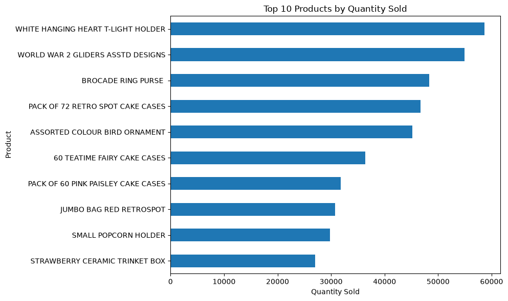
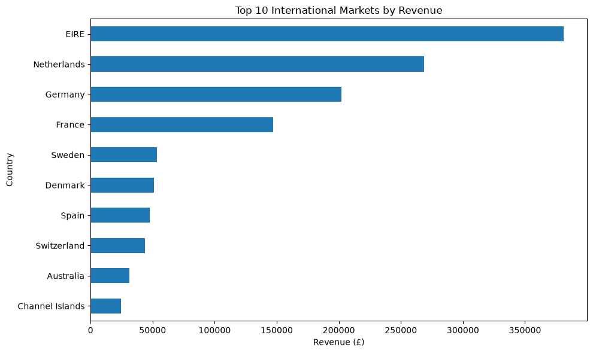
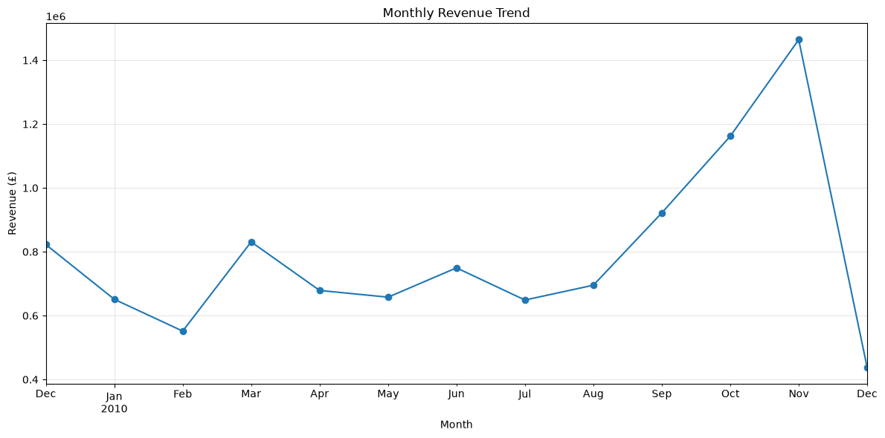

# Online Retail Data Analysis

## Overview

This project analyzes transactional data from an online retail store. The goal is to clean and preprocess the raw dataset, explore sales patterns, visualize key trends, and identify useful business insights about products, customers, revenue, and geographic markets.

The analysis is performed in Python using Pandas and Matplotlib in a Jupyter Notebook.

## Dataset

The project uses the Online Retail II dataset, which contains transactional data from a UK-based online retailer.

The analyzed data includes:

- Invoice numbers
- Product codes and descriptions
- Quantities
- Invoice dates
- Product prices
- Customer IDs
- Customer countries

The raw dataset is not included in this repository.

## Objectives

- Inspect and understand the dataset
- Identify missing, invalid, and duplicate data
- Clean and preprocess transaction records
- Separate cancelled transactions from valid sales
- Perform exploratory data analysis (EDA)
- Analyze product and geographic sales performance
- Visualize important sales patterns
- Identify key business insights

## Data Cleaning

The cleaning process includes:

- Removing duplicate records
- Identifying cancelled transactions
- Filtering non-positive quantities and prices from valid sales
- Investigating missing values
- Retaining transactions with missing Customer IDs when customer identification is not required for sales-level analysis
- Creating a separate dataset containing valid completed sales

## Feature Engineering

Several additional features are created to support the analysis:

- `Revenue` — calculated as Quantity × Price
- `Year`
- `Month`
- `Day`
- `Hour`
- `DayOfWeek`
- `YearMonth`

## Analysis

The exploratory analysis covers:

- Overall sales performance
- Top-selling products by quantity
- Products generating the highest revenue
- Revenue by country
- Monthly revenue trends
- Revenue by day of the week

## Visualizations

### Top 10 Products by Quantity Sold



### Top 10 International Markets by Revenue



### Monthly Revenue Trend



## Key Findings

- The cleaned sales dataset contains 504,730 transaction records representing 20,951 unique orders.
- Total revenue from valid sales was approximately £10.27 million.
- The dataset contains 4,251 unique products and 4,312 identified customers.
- `WHITE HANGING HEART T-LIGHT HOLDER` was the best-selling product by quantity, with 58,691 units sold.
- The United Kingdom was the dominant market, generating approximately £8.81 million in revenue.
- Among international markets, Ireland (EIRE), the Netherlands, Germany, and France generated the highest revenue.
- Revenue increased substantially during September, October, and November 2010, with November producing the highest monthly revenue.
- December 2010 contains only partial-month data and should not be directly compared with complete months.
- Some high-revenue descriptions such as `Manual`, `DOTCOM POSTAGE`, and `POSTAGE` appear to represent service or adjustment entries rather than ordinary retail products and should be interpreted separately.

## Technologies

- Python
- Pandas
- Matplotlib
- Jupyter Notebook
- OpenPyXL

## Repository Structure

```text
online-retail-analysis/
├── online_retail_analysis.ipynb
├── README.md
├── requirements.txt
└── .gitignore
```

## How to Run

1. Clone the repository.
2. Create and activate a Python virtual environment.
3. Install the required packages:

```bash
pip install -r requirements.txt
```

4. Download the Online Retail II dataset and place the Excel file in a `data` directory.
5. Open `online_retail_analysis.ipynb` in Jupyter Notebook.
6. Run the notebook cells from top to bottom.

## Conclusion

This project demonstrates a complete data analysis workflow, including data inspection, cleaning, feature engineering, exploratory data analysis, visualization, and interpretation of business results.
